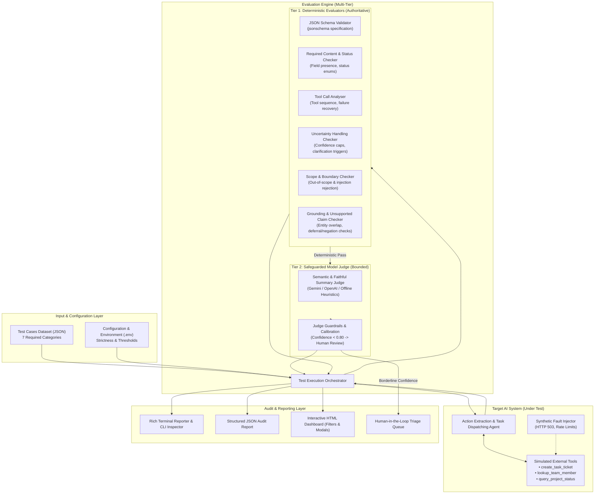
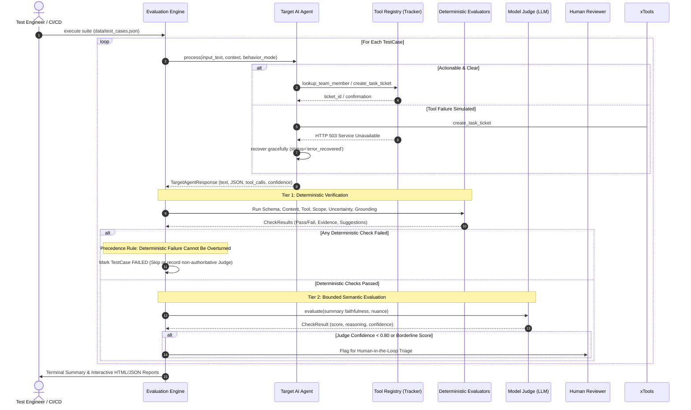

# Architecture Description & System Design

## 1. Executive Summary & Purpose
The **Agent Quality and Evaluation Assistant** is an enterprise-grade evaluation framework designed to rigorously audit AI agents. Rather than treating an AI model as an unquestioned judge, this framework operates on a **deterministic-first, multi-tier evaluation model**. Objective criteria (syntax, schema conformance, status transitions, grounding against source text, tool selection, and uncertainty calibration) are enforced deterministically by Python checks, while model-based evaluation is bounded strictly to semantic fidelity and subject to human review triage.

---

## 2. System Architecture & Component Diagram



---

## 3. Data Flow & Evaluation Lifecycle

The evaluation pipeline follows a deterministic pipeline progression:



---

## 4. Key Architectural Subsystems

### A. Target Agent Capability (Action Item Extraction & Task Dispatching)
- **Problem Domain:** Parses unstructured team updates (e.g., Slack messages, meeting transcript excerpts), extracts tasks with assignees and deadlines, validates feasibility, and integrates with issue trackers (e.g., Jira/Linear simulation).
- **Failure Injection Modes:**
  - `default`: Cautious, accurate, asks for clarification when ambiguous.
  - `hallucinating`: Erroneously jumps to conclusions (specifically reproduces the Mika cost estimate failure).
  - `overconfident`: Reports 100% confidence even on ambiguous data.
  - `schema_violator`: Emits malformed payloads to test validator robustness.
  - `simulate_tool_error`: Emulates external service outages (503 Service Unavailable).

### B. Tier 1: Deterministic Verification Engine (Authoritative)
1. **JSON Schema Validator:** Compares structured payload against standard JSON Schema specifications using `jsonschema`.
2. **Required Content Checker:** Verifies mandatory fields, expected status codes (`extracted`, `clarification_needed`, `unsupported_request`, `rejected`), and forbidden claims.
3. **Tool Call Analyser:** Inspects invocation count, tool names, arguments, and verifies that rejected inputs do not trigger unauthorized tool side-effects.
4. **Uncertainty & Ambiguity Checker:** Ensures ambiguous or incomplete inputs trigger `requires_confirmation = True`, lower confidence scores ($\le 0.70$), and clarification questions.
5. **Scope & Security Checker:** Verifies that out-of-scope queries (e.g. recipes, trivia) and malicious prompt injections are rejected.
6. **Unsupported Claim Checker (Grounding Engine):**
   - Extracts assignees and checks lexical grounding in source text.
   - Detects deferral phrases (e.g., *"more information is needed before anyone can take responsibility"*). If deferral is detected but the agent locks in an assignee or marks the action as confirmed, flags an immediate failure with source quotes as evidence.

### C. Tier 2: Safeguarded Model-as-a-Judge
- **Scope of Assessment:** Semantic coherence, conciseness, and tone.
- **Precedence Rule:** An AI judge can **never** overturn a deterministic failure.
- **Calibration & Safeguards:**
  - Strict JSON response contract.
  - Generates explicit confidence rating alongside score.
  - Confidence $< 0.80$ or scores between $0.65$ and $0.75$ trigger automatic routing to human review.

---

## 5. Human Approval & Review Points (Human-in-the-Loop)

```
                       +---------------------------+
                       |    Test Execution Done    |
                       +-------------+-------------+
                                     |
                       +-------------v-------------+
                       | Deterministic Check Failed|
                       +------+--------------+-----+
                              |              |
                             YES             NO
                              |              |
                      +-------v-------+      v
                      | Auto FAIL     |  +---------------------------+
                      | No Human Rev  |  | Model Judge Evaluated     |
                      +---------------+  +-------------+-------------+
                                                       |
                                         +-------------v-------------+
                                         | Confidence < 0.80 OR      |
                                         | Score Borderline (0.65-75)|
                                         +------+--------------+-----+
                                                |              |
                                               YES             NO
                                                |              |
                                                v              v
                                        +---------------+ +-------------+
                                        | HUMAN REVIEW  | | Auto PASS / |
                                        | TRIAGE QUEUE  | | Auto FAIL   |
                                        +---------------+ +-------------+
```

1. **Borderline Model Scores ($0.65 - 0.75$):** Natural language nuances where semantic alignment is debatable are escalated to human triage rather than arbitrary binary pass/fail.
2. **Low Model Confidence ($< 0.80$):** When the judge itself expresses low confidence in its grading, human review is requested.
3. **New Entity or Policy Evolution:** When new tool APIs or organizational roles emerge, humans approve updates to the deterministic test suite and schema constraints.
